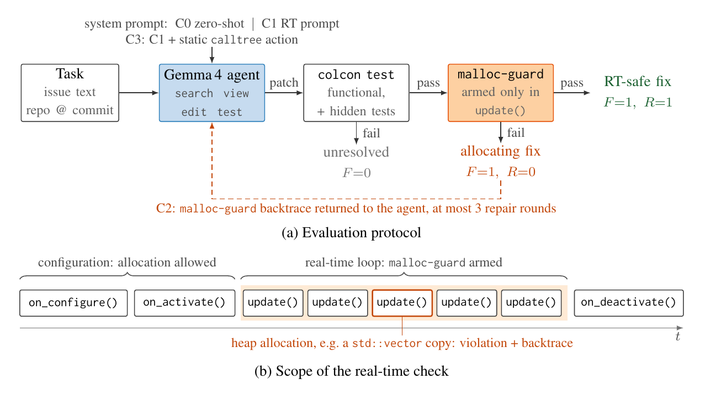
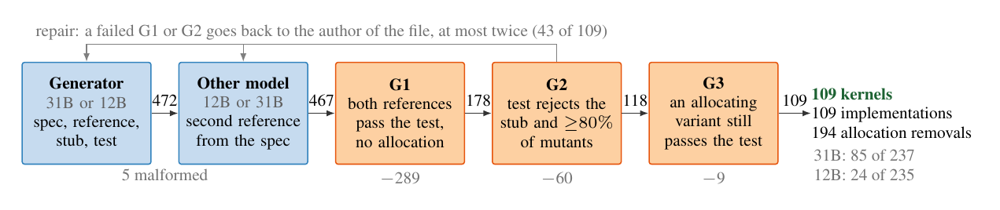
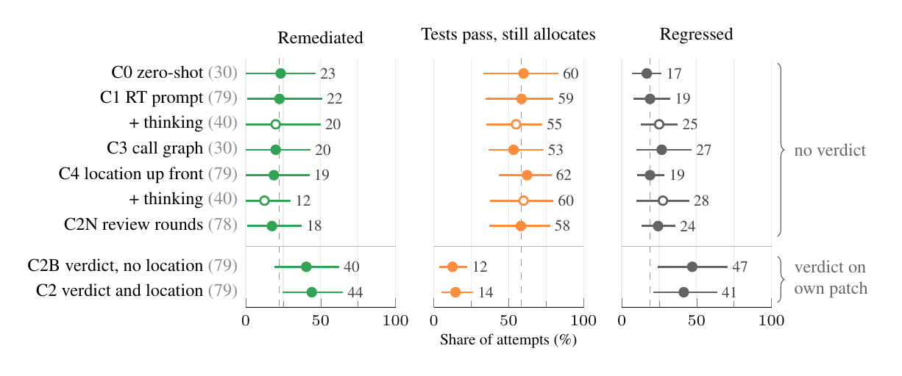

# RT-SWE-Bench

A benchmark for coding agents on real-time C++ code. A patch can pass every
test and still allocate heap memory on the real-time path, where allocation
latency has no useful bound. RT-SWE-Bench scores each patch with two checks:
the functional tests, and
[malloc-guard](https://github.com/intrinsic-ai/malloc-guard), an open-source
heap-allocation detector by Intrinsic, armed only around the real-time entry
point. A patch counts as fixed only if both pass.



Paper: *RT-SWE-Bench: Passing Tests Is Not Enough for Coding Agents on
Real-Time Code* (Kaggle Gemma 4 Paper Track, 2026).

## Contents

- 16 real tasks on [ros2_controllers](https://github.com/ros-controls/ros2_controllers)
  at commit `d71703b` (ROS 2 Jazzy), where every controller's `update()` must
  not allocate.
- 303 synthetic tasks on 109 self-contained real-time kernels, written by
  Gemma 4 31B and 12B and kept only when the verifier confirms them
  (pipeline below).
- The verifier, a pinned Docker image, the agent harness, every agent run and
  its re-score, and two censuses: heap allocation in `update()` of ten
  controllers, and in `run()` of 521 real-time LV2 audio plugins.

```
tasks/        the 16 real tasks (format: tasks/SCHEMA.md)
synthetic/    the synthetic tasks: dataset, generator, scoring (synthetic/README.md)
harness/      hidden tests and probes (rtswe_eval), static call graph (calltree)
docker/       the pinned image: ROS 2 Jazzy, ros2_controllers d71703b, malloc-guard cb7c445
scripts/      agent, scoring, matrix runner, analysis
census/       census of the controllers and of the LV2 plugins
results/      agent runs, re-scores in the container, census results
verify.sh     reproduces the task validation
figures/      the figures in this README
```

## Quick start

```
docker/build.sh          # once: builds the pinned image (30 to 60 min, 16 GB RAM or more)
./verify.sh              # rt-001: unpatched code, reference and naive patch (about a minute)
./verify.sh rt-006 rt-014
./verify.sh all          # all 16 tasks (about an hour)
```

`verify.sh` scores the task's starting point, the reference patch and the
naive patch, checks the verdicts against what the task requires, and compares
them with `tasks/<id>/validation.jsonl`. Without Docker,
`scripts/setup_native.sh` builds the same environment on Ubuntu 24.04; then
set `RTSWE_BACKEND=native`.

## Tasks

| Kind | Source | Tasks |
|---|---|---|
| Bug fix | reverted merged upstream fix | rt-006, rt-008, rt-012, rt-014 |
| Bug fix | hand-written bug | rt-015, rt-016 |
| Allocation removal | allocation in `update()` found by the census | rt-001 to rt-005, rt-007, rt-009 to rt-011, rt-013 |

- Bug fix: a functional bug on the update path. The hidden upstream tests are
  restored for scoring. Two of the merged fixes (#2624, #2359) allocate in
  `update()` themselves and serve as naive patches.
- Allocation removal: the tests pass, but `update()` allocates. The issue
  states how much, not where.
- Each task has an issue, hidden tests that drive the real-time loop, a
  reference patch (passes both checks) and a naive patch (passes only the
  tests). In `task.json`, `"track": 1` is a bug fix and `"track": 2` an
  allocation removal.

Example, rt-006: with a NaN reference the mecanum drive controller stopped
only one wheel. The merged fix
([#2624](https://github.com/ros-controls/ros2_controllers/pull/2624)) passes
all 37 package tests and builds a new `std::deque` on every cycle of this
branch. It is the task's naive patch; the reference resets the history in
place:

```diff
 else  // reference is NaN: stop every wheel
 {
-  previous_two_commands_ = std::queue<std::array<double, 3>>(
-    std::deque<std::array<double, 3>>{{{0.0, 0.0, 0.0}}, {{0.0, 0.0, 0.0}}});
+  previous_two_commands_.front() = {{0.0, 0.0, 0.0}};
+  previous_two_commands_.back() = {{0.0, 0.0, 0.0}};
```

### Synthetic tasks

Gemma 4 writes self-contained real-time kernels; the verifier decides what
enters the dataset. One model writes a specification, a reference, a stub and
a test, the other model a second reference from the specification alone.
Numbers on the arrows are the candidates left after each step
(`synthetic/README.md`).



## Running an agent

The agent talks to any OpenAI-compatible server (we used vLLM 0.32.0) and has
five actions: search, view, edit, test, submit. Conditions:

| | Agent gets |
|---|---|
| C0 | the issue and the repository |
| C1 | C0 and a system prompt that states the real-time contract |
| C2 | C1 and up to three repair rounds with the malloc-guard report (sites and backtrace) |
| C2B | C1 and up to three repair rounds that say only how many bytes `update()` still allocates |
| C2N | C1 and three review rounds without a verdict |
| C3 | C1 and a `calltree` action that lists allocations statically reachable from `update()` |
| C4 | C1 and the malloc-guard report of the unpatched code in the issue |

```
scripts/agent.py --task tasks/rt-001 --condition C1 --base-url http://localhost:8000/v1
scripts/run_matrix.py --conditions C0,C1,C2,C3 --samples 3 --workers 4
scripts/rescore_runs.py results/runs --out results/rescore/<model>.jsonl   # re-score in the container
```

`RTSWE_THINKING=1` turns on Gemma 4's thinking mode (C1T and C4T in the paper).
Prompts are in `scripts/agent.py` and in the paper's appendix.

## Results

Gemma 4 31B on the ten real allocation removals: share of attempts per
outcome, 95% bootstrap intervals over tasks, open circles with thinking on,
dashed line C1, run counts in grey (paper, Figure 4).



Knowing where the allocation is does not help; being told that the patch
still allocates does. On the synthetic allocation removals the same model
remediates 97% in C0.

<details>
<summary>The same numbers as a table</summary>

| Condition | Runs | Remediated | Tests pass, still allocates | Tests broken |
|---|---|---|---|---|
| C0 zero-shot | 30 | 23 [0, 47] | 60 | 17 |
| C1 real-time prompt | 79 | 22 [1, 51] | 59 | 19 |
| C3 call graph | 30 | 20 [0, 43] | 53 | 27 |
| C4 location up front | 79 | 19 [0, 42] | 62 | 19 |
| C2N review rounds, no verdict | 78 | 18 [1, 38] | 58 | 24 |
| C2B verdict, no location | 79 | 40 [19, 62] | 12 | 47 |
| C2 verdict and location | 79 | 44 [24, 65] | 14 | 41 |

</details>

To reproduce the paper's tables from the stored runs:

```
R=results/rescore
scripts/analyze_runs.py --rescore $R/gemma-4-31B-it-qat-w4a16-ct.jsonl \
    $R/gemma-4-12B-it-qat-w4a16-ct.jsonl $R/test_edits_dropped.jsonl            # Table 2
scripts/analyze_ablation.py --rescore $R/gemma-4-31B-it-qat-w4a16-ct.jsonl \
    $R/gemma-4-31B-it-qat-w4a16-ct-thinking.jsonl $R/test_edits_dropped.jsonl   # Figure 4
scripts/agent_synthetic.py report --runs results/synthetic_runs                 # Table 5
```

`results/runs/` also holds runs of three Qwen models on the allocation
removals, which the paper does not report.

## Scope

[malloc-guard](https://github.com/intrinsic-ai/malloc-guard) detects heap allocation through `malloc`, `calloc`, `realloc`
and `posix_memalign` (which covers `operator new`). It does not detect
blocking calls, locks or timing violations, so a passing patch meets a
necessary condition for real-time safety, not a sufficient one.

## License and citation

Apache License 2.0 (`LICENSE`).
[ros2_controllers](https://github.com/ros-controls/ros2_controllers) and
[malloc-guard](https://github.com/intrinsic-ai/malloc-guard) are Apache-2.0 as well.

```bibtex
@misc{loeffler2026rtswebench,
  title        = {{RT-SWE-Bench}: Passing Tests Is Not Enough for Coding Agents on Real-Time Code},
  author       = {Loeffler, Andreas and Bruenau, Benjamin},
  year         = {2026},
  howpublished = {\url{https://github.com/andreas-loeffler/rt-swe-bench}}
}
```
